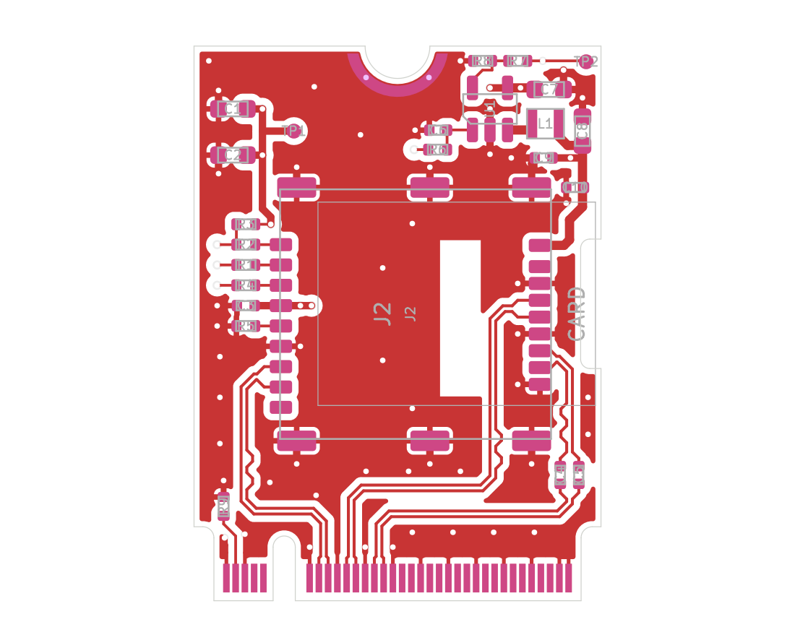

# microSD Express to M.2 2230 (Key M) adapter

A 22 x 30 mm M.2 module that holds a microSD Express card and presents it to
the host as an NVMe SSD on one PCIe Gen3 lane. It is a passive pass-through
plus a 1.8 V regulator and two AC-coupling capacitors. No bridge chip, no
firmware.



**Status: revision A0, design only. Not fabricated, not tested.** The
schematic and the routed four-layer layout agree with each other and the
layout passes KiCad's design-rule check. Before ordering boards, work through
the list in [DESIGN.md](DESIGN.md#9-open-issues-and-the-list-to-clear-before-ordering):
the differential-pair geometry is a placeholder until it is taken from your
fabricator's impedance calculator, and the socket footprint has not been
compared with the manufacturer's drawing.

Only microSD Express cards work. Ordinary microSD cards are not damaged, but a
PCIe-only host cannot see them.

## What is here

| Path | Contents |
|---|---|
| `hardware/` | KiCad 7 project: schematic, routed board, project library |
| `DESIGN.md` | the design: pin maps, rationale, footprints, layout, verification, open issues, how to change things |
| `docs/` | schematic PDF, layer images, BOM, DRC and verification reports |
| `tools/` | Python that generates the KiCad files, checks them, and exports outputs |
| `NOTICE.md` | third-party material; no licence chosen yet |

## Looking at it

Open `hardware/msdx_m2_2230.kicad_pro` in KiCad 7 or later. KiCad 8 and 9
convert the files when they save, after which KiCad 7 cannot open them.

For the 3D view of the socket, download Amphenol's STEP model as described in
`hardware/lib/3d/README.md`.

Without KiCad: `docs/schematic.pdf` and the images in `docs/img/`.

## Changing it

The KiCad files are generated from `tools/msdx/*.py`:

```
sh tools/build.sh         # regenerate and verify
sh tools/export_docs.sh   # refresh docs/
```

This needs KiCad 7 with `kicad-cli` and the `pcbnew` Python module (on Ubuntu
24.04: `apt install kicad`). You can instead edit the project directly in KiCad
and stop using the generator. Both ways are described in
[DESIGN.md, section 10](DESIGN.md#10-working-on-the-design).

## Bill of materials

One Amphenol 10102166A812A socket, one TI TLV62568DBVR buck regulator, one
2.2 uH 2016 inductor, 10 capacitors and 9 resistors (0402 and 0603), all on
the top side. Full list: [docs/bom.csv](docs/bom.csv).

## Credits

The idea and the proof that it works come from two community projects:
[vapetrov/microSD_express_Pi](https://github.com/vapetrov/microSD_express_Pi)
and [M1cha/sdexpress_pcbs](https://github.com/M1cha/sdexpress_pcbs).
